# 📚 Telecom Churn Project — Complete Learning Guide

> **Purpose:** A complete learning companion for this project.
> Every concept is explained with **What · Why · How · Real World · How to Use**.
> Updated after every phase as the project progresses.

---

## 📌 Table of Contents

| # | Section | Status |
|---|---|---|
| 1 | [Prerequisites](#prerequisites) | ✅ Ready |
| 2 | [Project Big Picture](#project-overview) | ✅ Ready |
| 3 | [Phase 0 — Requirement Planning](#phase-0) | ✅ Done |
| 4 | [Phase 1 — Environment Setup](#phase-1) | ✅ Done |
| 5 | [Phase 2 — Initial Data Inspection](#phase-2) | ✅ Done |
| 6 | [Phase 3 — Data Understanding Notebook](#phase-3) | ✅ Done |
| 7 | [Phase 4 — Data Cleaning](#phase-4) | 🔜 Coming Soon |
| 8 | [Phase 5 — Feature Engineering](#phase-5) | 🔜 Coming Soon |
| 9 | [Phase 6 — Customer Risk Segmentation](#phase-6) | 🔜 Coming Soon |
| 10 | [Phase 7 — Exploratory Churn Analysis](#phase-7) | 🔜 Coming Soon |
| 11 | [Phase 8 — SQL Database](#phase-8) | 🔜 Coming Soon |
| 12 | [Phase 9–10 — Power Query and Power BI Model](#phase-9-10) | 🔜 Coming Soon |
| 13 | [Phase 11 — DAX Measures](#phase-11) | 🔜 Coming Soon |
| 14 | [Phase 12–17 — Dashboard Pages](#phase-12-17) | 🔜 Coming Soon |
| 15 | [Glossary](#glossary) | 🔜 Coming Soon |

---

<h2 id="prerequisites">🧱 1. Prerequisites — What You Should Know</h2>

### Skill Map — What This Project Uses

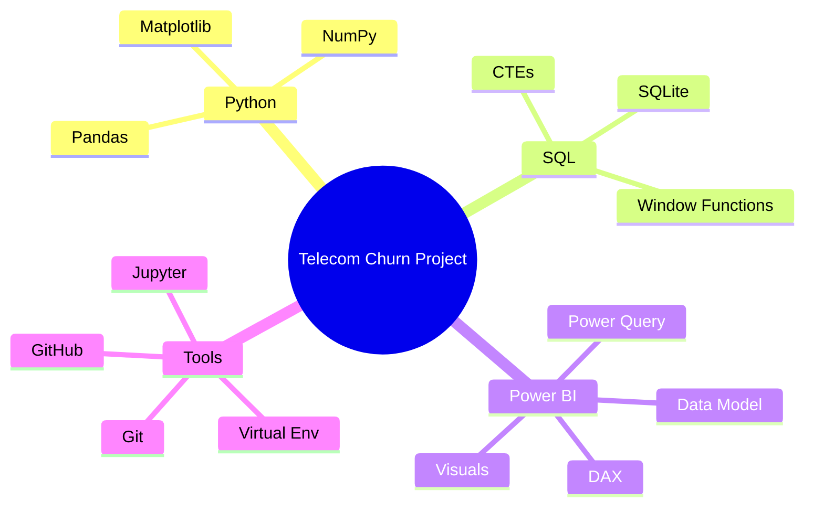

---

### 🐍 Python

| | Details |
|---|---|
| **What** | A programming language used for data analysis |
| **Why** | Python is the #1 tool for data work. Almost every analyst/scientist job requires it |
| **Real World** | Netflix analyzes user watch behavior. Banks use it to detect fraud |

**Key operations you need to know:**
```python
# Variables
name = "Telecom"
churn_rate = 26.54

# If conditions
if churn_rate > 20:
    print("High churn — action needed")

# Loops
for col in df.columns:
    print(col)

# Functions
def calculate_churn_rate(churned, total):
    return round((churned / total) * 100, 2)
```

---

### 🐼 Pandas

| | Details |
|---|---|
| **What** | Python library for working with tabular data — like Excel but in code |
| **Why** | Clean, filter, group, and transform millions of rows in seconds — Excel cannot do this |
| **Real World** | Swiggy uses Pandas to process millions of daily orders |

**Key operations:**
```python
df.head()                          # First 5 rows
df.shape                           # (rows, columns)
df.info()                          # Column types and null counts
df.describe()                      # Statistics (mean, min, max)
df.isnull().sum()                  # Count missing values per column
df['Churn'].value_counts()         # Count unique values
df.groupby('Contract')['Churn'].mean()  # Group and aggregate
df.rename(columns={'old': 'new'})  # Rename columns
df.drop_duplicates()               # Remove duplicate rows
pd.to_numeric(df['col'], errors='coerce')  # Convert text to number
```

---

### 🔢 NumPy

| | Details |
|---|---|
| **What** | Python library for numerical and array operations |
| **Why** | Pandas is built on NumPy. It handles math on large datasets efficiently |
| **Used in this project** | Creating binary flags (0/1), calculating medians and quartiles |

```python
import numpy as np

np.where(condition, "Yes_value", "No_value")  # Conditional column
df['col'].quantile(0.75)                       # 75th percentile (Q3)
df['col'].median()                             # Median value
```

---

### 📊 Matplotlib

| | Details |
|---|---|
| **What** | Python library for creating charts |
| **Why** | Visualizing data helps spot patterns that raw numbers hide |
| **Real World** | Used in research, journalism, finance for data storytelling |

```python
import matplotlib.pyplot as plt

plt.bar(['Month-to-month', 'One year', 'Two year'], [42.7, 11.3, 2.8])
plt.title('Churn Rate by Contract Type')
plt.xlabel('Contract')
plt.ylabel('Churn Rate (%)')
plt.show()
```

---

### 🗄️ SQL

| | Details |
|---|---|
| **What** | Language to query data stored in databases |
| **Why** | Every company stores data in databases. SQL is the universal language to access it |
| **Real World** | Analysts at banks, e-commerce, and telecom companies use SQL daily |

**Key operations:**
```sql
-- Basic query
SELECT contract, COUNT(*) AS customers
FROM telco_customers
GROUP BY contract
ORDER BY customers DESC;

-- Churn rate calculation
SELECT
    contract,
    COUNT(*) AS total,
    SUM(churn_flag) AS churned,
    ROUND(100.0 * SUM(churn_flag) / COUNT(*), 2) AS churn_rate
FROM telco_customers
GROUP BY contract;

-- CTE (reusable block)
WITH segment_data AS (
    SELECT risk_segment, COUNT(*) AS customers
    FROM telco_customers
    GROUP BY risk_segment
)
SELECT * FROM segment_data ORDER BY customers DESC;

-- Window function (ranking)
SELECT contract,
       DENSE_RANK() OVER (ORDER BY churn_rate DESC) AS rank
FROM segment_data;
```

---

### ⚡ Power BI

| | Details |
|---|---|
| **What** | Microsoft tool to build interactive business dashboards |
| **Why** | Decision-makers don't look at code. They look at dashboards. Power BI turns analysis into a product |
| **Real World** | Used by Microsoft, Deloitte, banks, retail, and telecom companies globally |

**How the components connect:**
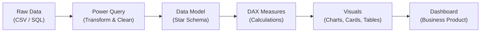

---

### 🗃️ Git and GitHub

| | Details |
|---|---|
| **What** | Git = version control. GitHub = online storage for your Git repository |
| **Why** | Every software and data team uses Git. It is also your professional portfolio |
| **Real World** | Every company from startups to Google uses Git. Not knowing it is a red flag |

**Key commands:**
```bash
git init          # Start tracking a folder
git add .         # Stage all changes
git commit -m ""  # Save a snapshot with a message
git push          # Upload to GitHub
git pull          # Download latest from GitHub
git log           # See commit history
git diff          # See what changed
```

---

<h2 id="project-overview">🗺️ 2. Project Big Picture</h2>

### What is Customer Churn?

> **Churn** = A customer who stopped using the service and cancelled.

**The business cost of churn:**

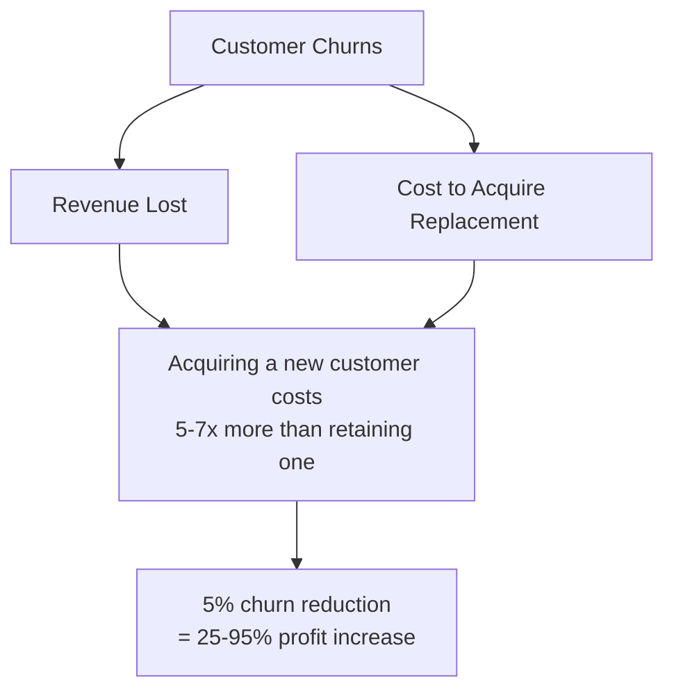

**Real-world companies doing this exact analysis:**

| Company | What they analyze |
|---|---|
| Airtel / Jio | Customers likely to switch carriers |
| Netflix / Hotstar | Subscribers about to cancel |
| Banks | Customers about to close accounts |
| Amazon Prime | Members not renewing |

---

### End-to-End Data Pipeline

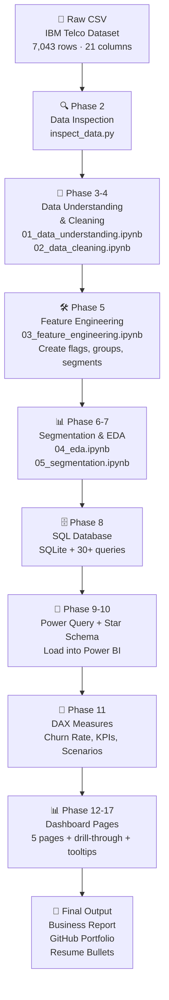

---

### Key Metrics at a Glance

| Metric | Formula | Our Value |
|---|---|---|
| Total Customers | COUNT of all rows | 7,043 |
| Churned Customers | COUNT where Churn = Yes | 1,869 |
| Retained Customers | COUNT where Churn = No | 5,174 |
| **Churn Rate** | (Churned / Total) × 100 | **26.54%** |
| Retention Rate | (Retained / Total) × 100 | 73.46% |

---

<h2 id="phase-0">📋 3. Phase 0 — Requirement Planning</h2>

### What We Did

Created `docs/business_requirements.md` before writing a single line of code.

### Why Before Coding?

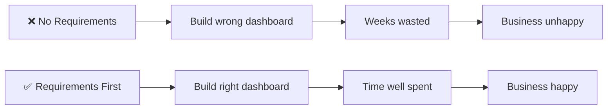

### Stakeholder Map

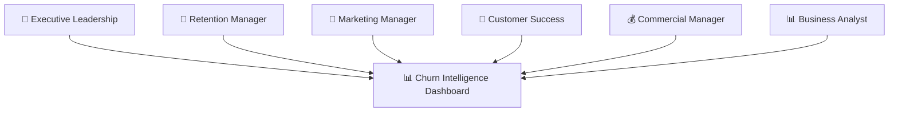

### Scope Boundaries

| In Scope ✅ | Out of Scope ❌ |
|---|---|
| Customer churn analysis | Guaranteed churn prediction (ML model) |
| Contract and tenure analysis | Real-time customer scoring |
| Pricing and service analysis | Production model deployment |
| Risk segmentation | Revenue forecasting |
| Retention recommendations | Customer contact automation |
| Power BI dashboard | Causal claims |
| Scenario analysis | Personal data enrichment |

### Success Criteria

- [ ] Every business question maps to an analysis
- [ ] Every KPI has a clear definition
- [ ] Customer totals match across Python, SQL, and Power BI
- [ ] Segmentation logic is transparent and documented
- [ ] Dashboard filters all work correctly
- [ ] Recommendations are based on real findings, not assumptions

### Files Created

| File | Purpose |
|---|---|
| `docs/business_requirements.md` | Stakeholders, scope, objectives, success criteria |

---

<h2 id="phase-1">⚙️ 4. Phase 1 — Environment Setup</h2>

### What We Did

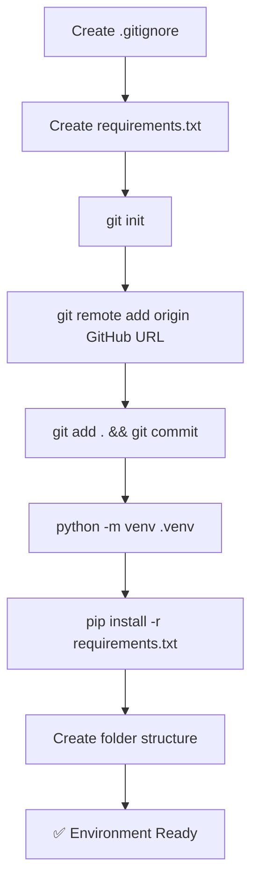

---

### Deep Dive — Virtual Environment

**The Problem:**
```
Project A needs pandas==1.0
Project B needs pandas==2.0
→ They CANNOT both be the global version
```

**The Solution:**
```
.venv/  ← Isolated Python for THIS project only
   └── Lib/
       └── pandas==2.0  ← Only lives here, not globally
```

**Commands:**
```powershell
python -m venv .venv                # Create
.\.venv\Scripts\Activate.ps1        # Activate (Windows PowerShell)
pip install -r requirements.txt     # Install packages inside venv
```

---

### Deep Dive — requirements.txt

```text
pandas       ← Data manipulation (read, clean, filter, group)
numpy        ← Numerical math (quartiles, medians, flags)
matplotlib   ← Charts and visualizations
sqlalchemy   ← Connect Python to SQL databases
jupyter      ← Run .ipynb notebook files interactively
```

**Anyone cloning the repo just runs:**
```bash
pip install -r requirements.txt
```
...and gets the exact same environment. This is **reproducibility**.

---

### Deep Dive — Folder Structure

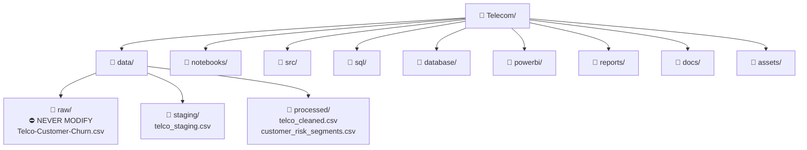

---

### Deep Dive — Git Workflow

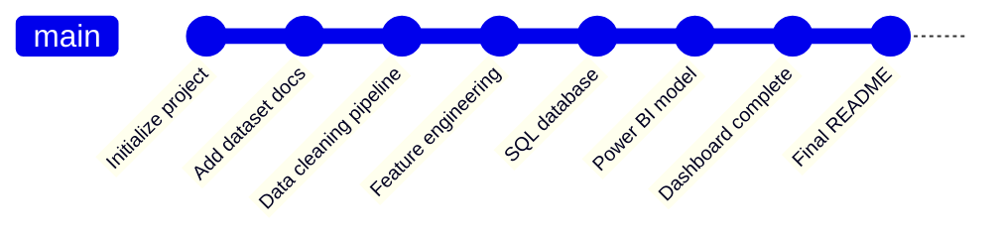

### Files Created in Phase 1

| File / Folder | Purpose |
|---|---|
| `.gitignore` | Tells Git what to skip |
| `requirements.txt` | Package list for reproducibility |
| `.venv/` | Isolated Python environment |
| `data/raw/`, `staging/`, `processed/` | Data layer |
| `notebooks/`, `sql/`, `powerbi/` | Work areas |
| `reports/`, `docs/`, `assets/` | Documentation |

---

<h2 id="phase-2">🔍 5. Phase 2 — Initial Data Inspection</h2>

### What We Did

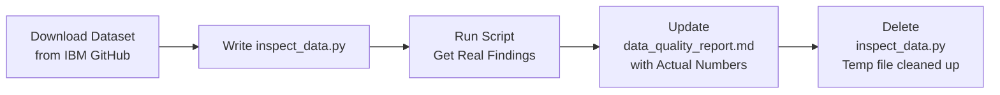

---

### Why Inspect Before Doing Anything?

This is called **Data Profiling**:

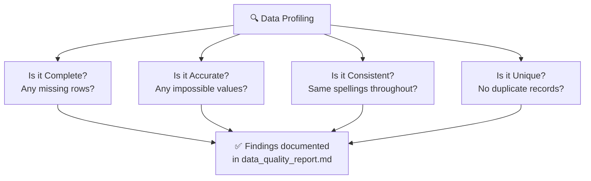

---

### Actual Findings From Our Dataset

| Check | Result | Severity | Action |
|---|---|---|---|
| Total rows | 7,043 | ✅ | None |
| Total columns | 21 | ✅ | None |
| Duplicate rows | 0 | ✅ | None |
| Duplicate customer IDs | 0 | ✅ | None |
| Null / NaN values | 0 | ✅ | None |
| **Blank TotalCharges** | **11 rows** | ⚠️ Medium | Fill with 0 where tenure=0 |
| Negative numeric values | 0 | ✅ | None |
| Unexpected Churn values | 0 | ✅ | None |

---

### Churn Distribution

| Status | Count | Percentage |
|---|---|---|
| Retained (No) | 5,174 | 73.46% |
| **Churned (Yes)** | **1,869** | **26.54%** |

```
Retained  ████████████████████████████░░░░░░░░░░░░  73.46%
Churned   ░░░░░░░░░░░░░░░░░░░░░░░░░░░░████████████  26.54%
```

> Roughly **1 in 4 customers churned**. This is the headline KPI for the entire project.

---

### The TotalCharges Issue — A Real Data Lesson

**What happened:**

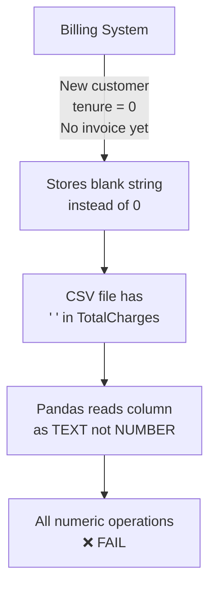

**The Fix:**
```python
# Step 1 — Convert text to number (blanks become NaN)
df['TotalCharges'] = pd.to_numeric(df['TotalCharges'], errors='coerce')

# Step 2 — Fill NaN with 0 for new customers (tenure = 0)
df.loc[df['tenure'].eq(0), 'TotalCharges'] = 0
```

**Why not delete those 11 rows?**
> They are real customers. Deleting data is always a last resort.
> Every cleaning decision must be **documented and justified**.

---

### The Golden Rule — Raw Data Is Sacred

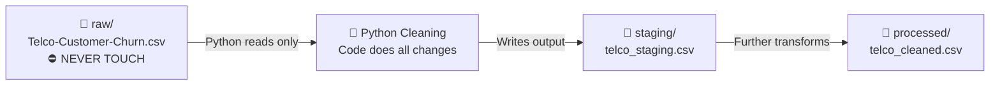

> If you overwrite the original and make a mistake → **data is gone forever**.
> By never touching the raw file, you can always restart from scratch.

---

### Category Breakdown (Key Columns)

**Contract Type:**
```
Month-to-month  ████████████████████████░  3,875  (55%)
Two year        █████████████░             1,695  (24%)
One year        ████████████░              1,473  (21%)
```

**Internet Service:**
```
Fiber optic  ██████████████████████░  3,096  (44%)
DSL          █████████████████░        2,421  (34%)
No           ███████████░              1,526  (22%)
```

**Payment Method:**
```
Electronic check          ████████████████░  2,365  (34%)
Mailed check              ███████████░       1,612  (23%)
Bank transfer (auto)      ███████████░       1,544  (22%)
Credit card (auto)        ███████████░       1,522  (22%)
```

---

### Files Created or Updated in Phase 2

| File | Purpose |
|---|---|
| `data/raw/Telco-Customer-Churn.csv` | Original untouched IBM dataset |
| `reports/data_quality_report.md` | Actual verified data quality findings |

---

## 📌 Concepts Summary (Phases 0–2)

| Concept | What | Why It Matters |
|---|---|---|
| **BRD** | Business Requirements Document | Prevents building the wrong thing |
| **Virtual Environment** | Isolated Python per project | Prevents package conflicts |
| **requirements.txt** | List of project packages | Makes project reproducible |
| **.gitignore** | Files Git should not track | Keeps repo clean |
| **Git commit** | Saved project snapshot | Enables version control and rollback |
| **Data Profiling** | Inspecting raw data programmatically | Finds issues before they break analysis |
| **Churn Rate** | % of customers who left | Core KPI of the project |
| **Raw data is sacred** | Never edit original file | Full data integrity and recoverability |
| **Data Quality Report** | Document of all issues found | Audit trail for every decision |
| **Blank vs Null** | `" "` (blank string) ≠ `NaN` (null) | Knowing this prevents silent data errors |

---

<h2 id="phase-3">📓 6. Phase 3 — Data Understanding Notebook</h2>

### What We Did

Created `notebooks/01_data_understanding.ipynb` — a 15-section notebook that reads the raw dataset and documents everything about it **without modifying a single value**.

---

### The Golden Rule of This Notebook

> **Observe. Document. Do NOT clean.**
> Cleaning happens in the next notebook. This one is purely for understanding.

---

### What the Notebook Covers (15 Sections)

| Section | What it does |
|---|---|
| 1 | Import libraries |
| 2 | Load raw dataset — always work on a `.copy()` |
| 3 | Preview rows — head, tail, random sample |
| 4 | Dataset shape and column list |
| 5 | Data types — spot wrong types immediately |
| 6 | Descriptive statistics — min, max, mean, std |
| 7 | Missing value analysis — NaN and blank strings |
| 8 | Duplicate analysis — rows and customer IDs |
| 9 | Unique value analysis — cardinality of each column |
| 10 | Category audit — all values in every text column |
| 11 | TotalCharges deep inspection — the blank string issue |
| 12 | Numeric range audit — tenure, charges |
| 13 | Churn distribution — bar chart and pie chart |
| 14 | Distributions — histograms for tenure and charges |
| 15 | Data quality report summary — all findings in one table |

---

### Deep Dive — Why Always Use `.copy()`?

```python
df_raw = pd.read_csv(RAW_FILE)   # Load raw
df = df_raw.copy()               # Work on a copy
```

**Why?** If you accidentally modify `df`, `df_raw` stays untouched. You can always reset with `df = df_raw.copy()` without reloading the file.

Without `.copy()`, both `df` and `df_raw` point to the same data in memory. Modifying one changes both.

---

### Deep Dive — Two Types of Missing Data

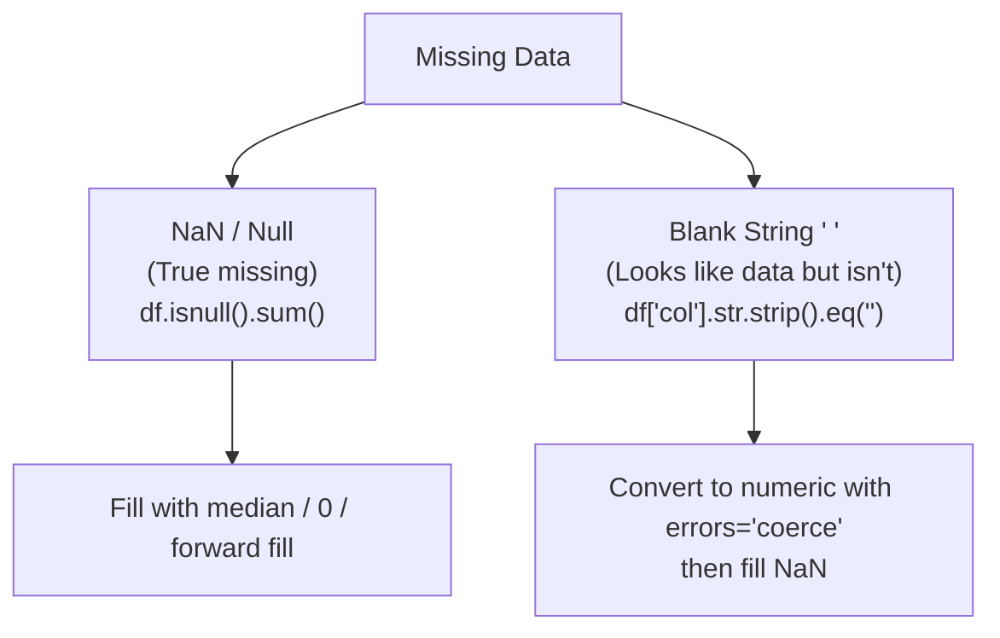

**In our dataset:**
- `NaN`: 0 columns have NaN
- `Blank string`: `TotalCharges` has 11 blank string rows

---

### Deep Dive — What is Cardinality?

**Cardinality** = number of unique values in a column.

| Column | Cardinality | Type |
|---|---|---|
| customerID | 7,043 (every row unique) | Identifier |
| gender | 2 | Low cardinality categorical |
| tenure | 73 | Numeric (0–72) |
| Contract | 3 | Low cardinality categorical |
| MonthlyCharges | ~1,585 | High cardinality numeric |

**Why it matters:**
- High cardinality text columns (like customerID) → don't group by these
- Low cardinality columns (like Contract) → perfect for grouping and analysis

---

### Deep Dive — Reading df.info() Output

```
RangeIndex: 7043 entries, 0 to 7042
Data columns (total 21 columns):
 customerID         7043 non-null  object    ← text
 SeniorCitizen      7043 non-null  int64     ← number (0 or 1)
 tenure             7043 non-null  int64     ← number
 MonthlyCharges     7043 non-null  float64   ← decimal number
 TotalCharges       7043 non-null  object    ← ⚠️ should be float64!
```

`TotalCharges` showing as `object` instead of `float64` is the red flag. This is because of those 11 blank string rows — Pandas cannot store a column as numeric if even one value is a non-numeric string.

---

### Charts Produced

| Chart | Saved to |
|---|---|
| Churn distribution (bar + pie) | `assets/churn_distribution.png` |
| Numeric distributions (histograms) | `assets/numeric_distributions.png` |

---

### Key Takeaways from Phase 3

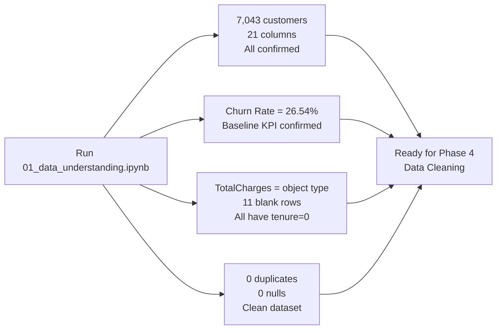

---

### Files Created in Phase 3

| File | Purpose |
|---|---|
| `notebooks/01_data_understanding.ipynb` | Full data understanding notebook (15 sections) |
| `assets/churn_distribution.png` | Churn bar + pie chart |
| `assets/numeric_distributions.png` | Tenure and charges histograms |

---

<h2 id="phase-4">🧹 7. Phase 4 — Data Cleaning</h2>

> 🔜 This section will be filled in after we complete Phase 4.

---

<h2 id="phase-5">🛠️ 8. Phase 5 — Feature Engineering</h2>

> 🔜 This section will be filled in after we complete Phase 5.

---

<h2 id="phase-6">🎯 9. Phase 6 — Customer Risk Segmentation</h2>

> 🔜 This section will be filled in after we complete Phase 6.

---

<h2 id="phase-7">📊 10. Phase 7 — Exploratory Churn Analysis</h2>

> 🔜 This section will be filled in after we complete Phase 7.

---

<h2 id="phase-8">🗄️ 11. Phase 8 — SQL Database</h2>

> 🔜 This section will be filled in after we complete Phase 8.

---

<h2 id="phase-9-10">🔌 12. Phase 9–10 — Power Query and Power BI Model</h2>

> 🔜 This section will be filled in after we complete Phases 9 and 10.

---

<h2 id="phase-11">📐 13. Phase 11 — DAX Measures</h2>

> 🔜 This section will be filled in after we complete Phase 11.

---

<h2 id="phase-12-17">📊 14. Phase 12–17 — Dashboard Pages</h2>

> 🔜 This section will be filled in after we complete Phases 12 to 17.

---

<h2 id="glossary">📖 15. Glossary</h2>

| Term | Meaning |
|---|---|
| **Churn** | Customer who cancelled their subscription |
| **Churn Rate** | (Churned / Total) × 100 |
| **Retention Rate** | (Retained / Total) × 100 |
| **Data Profiling** | Inspecting raw data before any transformation |
| **Feature Engineering** | Creating new calculated columns from existing data |
| **Star Schema** | Database design with one fact table + multiple dimension tables |
| **DAX** | Data Analysis Expressions — Power BI formula language |
| **KPI** | Key Performance Indicator — a measurable business metric |
| **EDA** | Exploratory Data Analysis — visual and statistical exploration |
| **CTE** | Common Table Expression — named temporary result in SQL |
| **Window Function** | SQL function calculating across a related set of rows |
| **Virtual Environment** | Isolated Python setup for one project |
| **Reproducibility** | Ability to recreate results from scratch |
| **BRD** | Business Requirements Document |
| **BI** | Business Intelligence — turning data into business insights |

---

*This file is updated after every phase. Read it alongside the project build.*
