# 📚 Telecom Churn Project — Complete Learning Guide

> **Purpose:** A complete learning companion for this project.
> Every concept is explained with **What · Why · How · Real World · How to Use**.
> Updated after every phase as the project progresses.

---

## 📌 Table of Contents

| # | Section | Status |
|---|---|---|
| 1 | [Prerequisites](#prerequisites) | ✅ Ready |
| 2 | [Project Big Picture](#project-overview) | ✅ Ready |
| 3 | [Phase 0 — Requirement Planning](#phase-0) | ✅ Done |
| 4 | [Phase 1 — Environment Setup](#phase-1) | ✅ Done |
| 5 | [Phase 2 — Initial Data Inspection](#phase-2) | ✅ Done |
| 6 | [Phase 3 — Data Understanding Notebook](#phase-3) | ✅ Done |
| 7 | [Phase 4 — Data Cleaning](#phase-4) | ✅ Done |
| 8 | [Phase 5 — Feature Engineering](#phase-5) | ✅ Done |
| 9 | [Phase 6 — Customer Risk Segmentation](#phase-6) | ✅ Done |
| 10 | [Phase 7 — Exploratory Churn Analysis](#phase-7) | ✅ Done |
| 11 | [Phase 8 — SQL Database](#phase-8) | ✅ Done |
| 12 | [Phase 9–10 — Power Query and Power BI Model](#phase-9-10) | ✅ Done |
| 13 | [Phase 11 — DAX Measures](#phase-11) | ✅ Done |
| 14 | [Phase 12–17 — Dashboard Pages](#phase-12-17) | ✅ Done |
| 15 | [Glossary](#glossary) | 🔜 Coming Soon |

---

<h2 id="prerequisites">🧱 1. Prerequisites — What You Should Know</h2>

### Skill Map — What This Project Uses

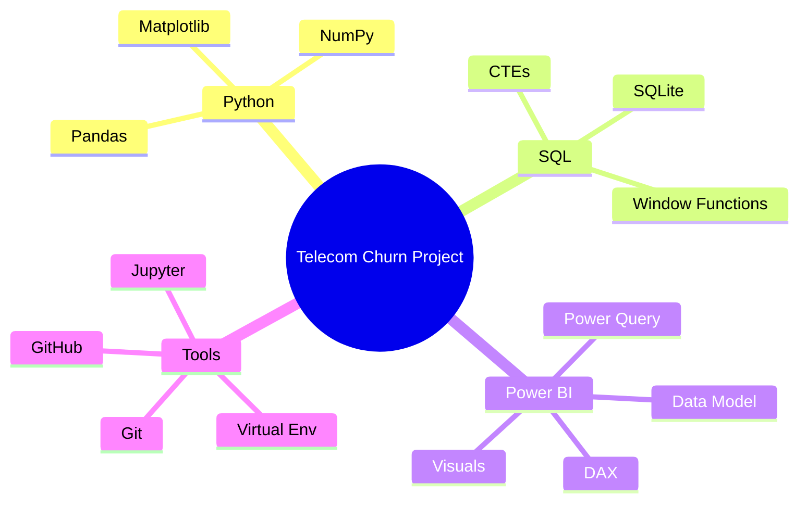

---

### 🐍 Python

| | Details |
|---|---|
| **What** | A programming language used for data analysis |
| **Why** | Python is the #1 tool for data work. Almost every analyst/scientist job requires it |
| **Real World** | Netflix analyzes user watch behavior. Banks use it to detect fraud |

**Key operations you need to know:**
```python
# Variables
name = "Telecom"
churn_rate = 26.54

# If conditions
if churn_rate > 20:
    print("High churn — action needed")

# Loops
for col in df.columns:
    print(col)

# Functions
def calculate_churn_rate(churned, total):
    return round((churned / total) * 100, 2)
```

---

### 🐼 Pandas

| | Details |
|---|---|
| **What** | Python library for working with tabular data — like Excel but in code |
| **Why** | Clean, filter, group, and transform millions of rows in seconds — Excel cannot do this |
| **Real World** | Swiggy uses Pandas to process millions of daily orders |

**Key operations:**
```python
df.head()                          # First 5 rows
df.shape                           # (rows, columns)
df.info()                          # Column types and null counts
df.describe()                      # Statistics (mean, min, max)
df.isnull().sum()                  # Count missing values per column
df['Churn'].value_counts()         # Count unique values
df.groupby('Contract')['Churn'].mean()  # Group and aggregate
df.rename(columns={'old': 'new'})  # Rename columns
df.drop_duplicates()               # Remove duplicate rows
pd.to_numeric(df['col'], errors='coerce')  # Convert text to number
```

---

### 🔢 NumPy

| | Details |
|---|---|
| **What** | Python library for numerical and array operations |
| **Why** | Pandas is built on NumPy. It handles math on large datasets efficiently |
| **Used in this project** | Creating binary flags (0/1), calculating medians and quartiles |

```python
import numpy as np

np.where(condition, "Yes_value", "No_value")  # Conditional column
df['col'].quantile(0.75)                       # 75th percentile (Q3)
df['col'].median()                             # Median value
```

---

### 📊 Matplotlib

| | Details |
|---|---|
| **What** | Python library for creating charts |
| **Why** | Visualizing data helps spot patterns that raw numbers hide |
| **Real World** | Used in research, journalism, finance for data storytelling |

```python
import matplotlib.pyplot as plt

plt.bar(['Month-to-month', 'One year', 'Two year'], [42.7, 11.3, 2.8])
plt.title('Churn Rate by Contract Type')
plt.xlabel('Contract')
plt.ylabel('Churn Rate (%)')
plt.show()
```

---

### 🗄️ SQL

| | Details |
|---|---|
| **What** | Language to query data stored in databases |
| **Why** | Every company stores data in databases. SQL is the universal language to access it |
| **Real World** | Analysts at banks, e-commerce, and telecom companies use SQL daily |

**Key operations:**
```sql
-- Basic query
SELECT contract, COUNT(*) AS customers
FROM telco_customers
GROUP BY contract
ORDER BY customers DESC;

-- Churn rate calculation
SELECT
    contract,
    COUNT(*) AS total,
    SUM(churn_flag) AS churned,
    ROUND(100.0 * SUM(churn_flag) / COUNT(*), 2) AS churn_rate
FROM telco_customers
GROUP BY contract;

-- CTE (reusable block)
WITH segment_data AS (
    SELECT risk_segment, COUNT(*) AS customers
    FROM telco_customers
    GROUP BY risk_segment
)
SELECT * FROM segment_data ORDER BY customers DESC;

-- Window function (ranking)
SELECT contract,
       DENSE_RANK() OVER (ORDER BY churn_rate DESC) AS rank
FROM segment_data;
```

---

### ⚡ Power BI

| | Details |
|---|---|
| **What** | Microsoft tool to build interactive business dashboards |
| **Why** | Decision-makers don't look at code. They look at dashboards. Power BI turns analysis into a product |
| **Real World** | Used by Microsoft, Deloitte, banks, retail, and telecom companies globally |

**How the components connect:**
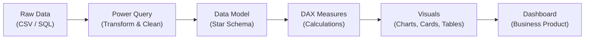

---

### 🗃️ Git and GitHub

| | Details |
|---|---|
| **What** | Git = version control. GitHub = online storage for your Git repository |
| **Why** | Every software and data team uses Git. It is also your professional portfolio |
| **Real World** | Every company from startups to Google uses Git. Not knowing it is a red flag |

**Key commands:**
```bash
git init          # Start tracking a folder
git add .         # Stage all changes
git commit -m ""  # Save a snapshot with a message
git push          # Upload to GitHub
git pull          # Download latest from GitHub
git log           # See commit history
git diff          # See what changed
```

---

<h2 id="project-overview">🗺️ 2. Project Big Picture</h2>

### What is Customer Churn?

> **Churn** = A customer who stopped using the service and cancelled.

**The business cost of churn:**

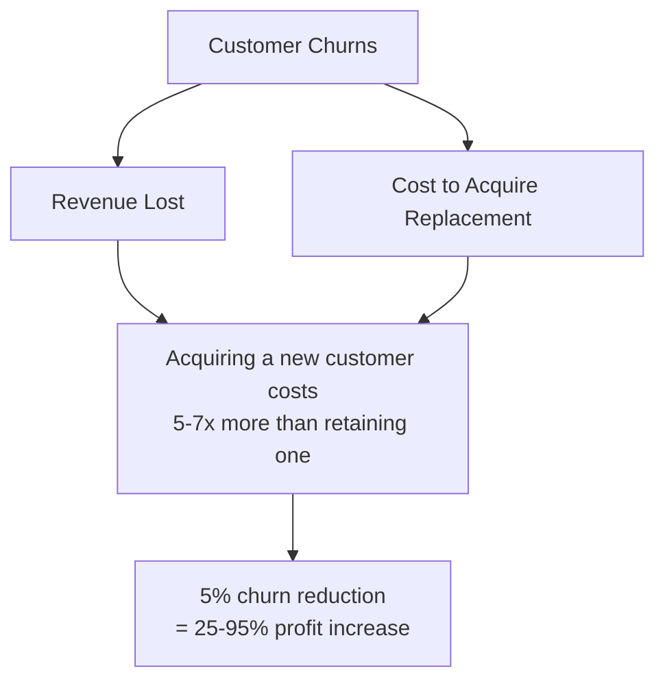

**Real-world companies doing this exact analysis:**

| Company | What they analyze |
|---|---|
| Airtel / Jio | Customers likely to switch carriers |
| Netflix / Hotstar | Subscribers about to cancel |
| Banks | Customers about to close accounts |
| Amazon Prime | Members not renewing |

---

### End-to-End Data Pipeline

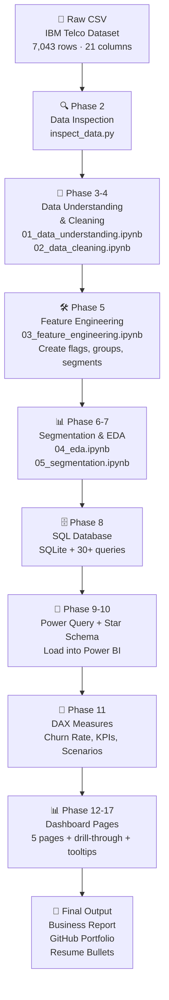

---

### Key Metrics at a Glance

| Metric | Formula | Our Value |
|---|---|---|
| Total Customers | COUNT of all rows | 7,043 |
| Churned Customers | COUNT where Churn = Yes | 1,869 |
| Retained Customers | COUNT where Churn = No | 5,174 |
| **Churn Rate** | (Churned / Total) × 100 | **26.54%** |
| Retention Rate | (Retained / Total) × 100 | 73.46% |

---

<h2 id="phase-0">📋 3. Phase 0 — Requirement Planning</h2>

### What We Did

Created `docs/business_requirements.md` before writing a single line of code.

### Why Before Coding?

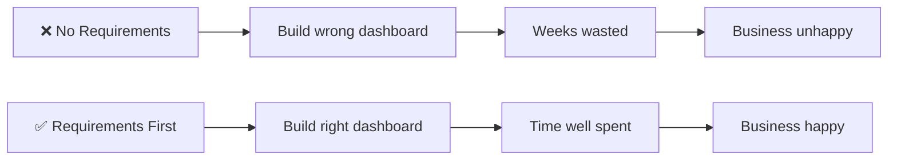

### Stakeholder Map

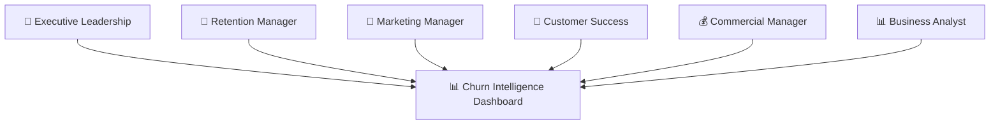

### Scope Boundaries

| In Scope ✅ | Out of Scope ❌ |
|---|---|
| Customer churn analysis | Guaranteed churn prediction (ML model) |
| Contract and tenure analysis | Real-time customer scoring |
| Pricing and service analysis | Production model deployment |
| Risk segmentation | Revenue forecasting |
| Retention recommendations | Customer contact automation |
| Power BI dashboard | Causal claims |
| Scenario analysis | Personal data enrichment |

### Success Criteria

- [ ] Every business question maps to an analysis
- [ ] Every KPI has a clear definition
- [ ] Customer totals match across Python, SQL, and Power BI
- [ ] Segmentation logic is transparent and documented
- [ ] Dashboard filters all work correctly
- [ ] Recommendations are based on real findings, not assumptions

### Files Created

| File | Purpose |
|---|---|
| `docs/business_requirements.md` | Stakeholders, scope, objectives, success criteria |

---

<h2 id="phase-1">⚙️ 4. Phase 1 — Environment Setup</h2>

### What We Did

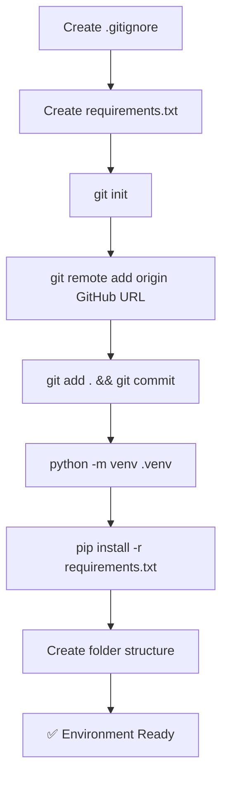

---

### Deep Dive — Virtual Environment

**The Problem:**
```
Project A needs pandas==1.0
Project B needs pandas==2.0
→ They CANNOT both be the global version
```

**The Solution:**
```
.venv/  ← Isolated Python for THIS project only
   └── Lib/
       └── pandas==2.0  ← Only lives here, not globally
```

**Commands:**
```powershell
python -m venv .venv                # Create
.\.venv\Scripts\Activate.ps1        # Activate (Windows PowerShell)
pip install -r requirements.txt     # Install packages inside venv
```

---

### Deep Dive — requirements.txt

```text
pandas       ← Data manipulation (read, clean, filter, group)
numpy        ← Numerical math (quartiles, medians, flags)
matplotlib   ← Charts and visualizations
sqlalchemy   ← Connect Python to SQL databases
jupyter      ← Run .ipynb notebook files interactively
```

**Anyone cloning the repo just runs:**
```bash
pip install -r requirements.txt
```
...and gets the exact same environment. This is **reproducibility**.

---

### Deep Dive — Folder Structure

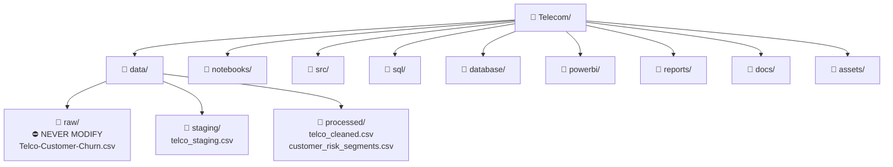

---

### Deep Dive — Git Workflow

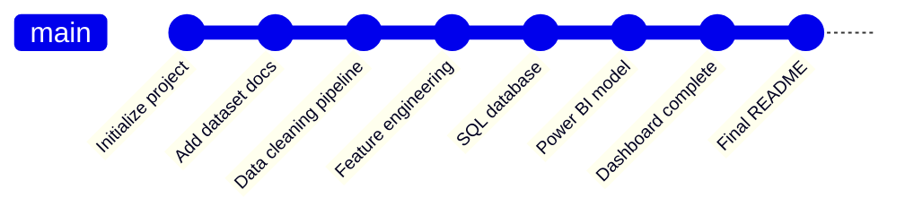

### Files Created in Phase 1

| File / Folder | Purpose |
|---|---|
| `.gitignore` | Tells Git what to skip |
| `requirements.txt` | Package list for reproducibility |
| `.venv/` | Isolated Python environment |
| `data/raw/`, `staging/`, `processed/` | Data layer |
| `notebooks/`, `sql/`, `powerbi/` | Work areas |
| `reports/`, `docs/`, `assets/` | Documentation |

---

<h2 id="phase-2">🔍 5. Phase 2 — Initial Data Inspection</h2>

### What We Did

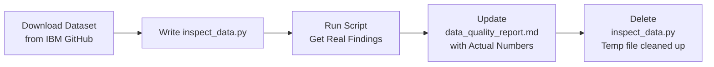

---

### Why Inspect Before Doing Anything?

This is called **Data Profiling**:

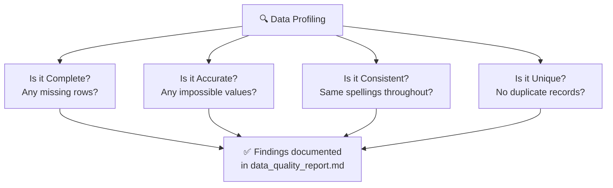

---

### Actual Findings From Our Dataset

| Check | Result | Severity | Action |
|---|---|---|---|
| Total rows | 7,043 | ✅ | None |
| Total columns | 21 | ✅ | None |
| Duplicate rows | 0 | ✅ | None |
| Duplicate customer IDs | 0 | ✅ | None |
| Null / NaN values | 0 | ✅ | None |
| **Blank TotalCharges** | **11 rows** | ⚠️ Medium | Fill with 0 where tenure=0 |
| Negative numeric values | 0 | ✅ | None |
| Unexpected Churn values | 0 | ✅ | None |

---

### Churn Distribution

| Status | Count | Percentage |
|---|---|---|
| Retained (No) | 5,174 | 73.46% |
| **Churned (Yes)** | **1,869** | **26.54%** |

```
Retained  ████████████████████████████░░░░░░░░░░░░  73.46%
Churned   ░░░░░░░░░░░░░░░░░░░░░░░░░░░░████████████  26.54%
```

> Roughly **1 in 4 customers churned**. This is the headline KPI for the entire project.

---

### The TotalCharges Issue — A Real Data Lesson

**What happened:**

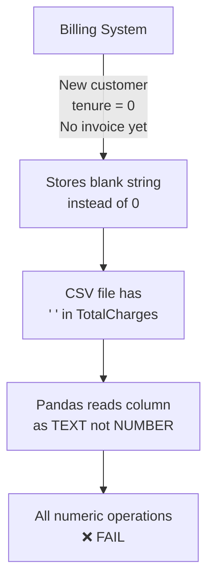

**The Fix:**
```python
# Step 1 — Convert text to number (blanks become NaN)
df['TotalCharges'] = pd.to_numeric(df['TotalCharges'], errors='coerce')

# Step 2 — Fill NaN with 0 for new customers (tenure = 0)
df.loc[df['tenure'].eq(0), 'TotalCharges'] = 0
```

**Why not delete those 11 rows?**
> They are real customers. Deleting data is always a last resort.
> Every cleaning decision must be **documented and justified**.

---

### The Golden Rule — Raw Data Is Sacred

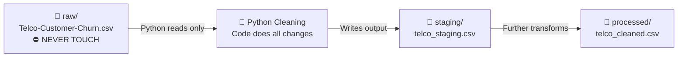

> If you overwrite the original and make a mistake → **data is gone forever**.
> By never touching the raw file, you can always restart from scratch.

---

### Category Breakdown (Key Columns)

**Contract Type:**
```
Month-to-month  ████████████████████████░  3,875  (55%)
Two year        █████████████░             1,695  (24%)
One year        ████████████░              1,473  (21%)
```

**Internet Service:**
```
Fiber optic  ██████████████████████░  3,096  (44%)
DSL          █████████████████░        2,421  (34%)
No           ███████████░              1,526  (22%)
```

**Payment Method:**
```
Electronic check          ████████████████░  2,365  (34%)
Mailed check              ███████████░       1,612  (23%)
Bank transfer (auto)      ███████████░       1,544  (22%)
Credit card (auto)        ███████████░       1,522  (22%)
```

---

### Files Created or Updated in Phase 2

| File | Purpose |
|---|---|
| `data/raw/Telco-Customer-Churn.csv` | Original untouched IBM dataset |
| `reports/data_quality_report.md` | Actual verified data quality findings |

---

## 📌 Concepts Summary (Phases 0–2)

| Concept | What | Why It Matters |
|---|---|---|
| **BRD** | Business Requirements Document | Prevents building the wrong thing |
| **Virtual Environment** | Isolated Python per project | Prevents package conflicts |
| **requirements.txt** | List of project packages | Makes project reproducible |
| **.gitignore** | Files Git should not track | Keeps repo clean |
| **Git commit** | Saved project snapshot | Enables version control and rollback |
| **Data Profiling** | Inspecting raw data programmatically | Finds issues before they break analysis |
| **Churn Rate** | % of customers who left | Core KPI of the project |
| **Raw data is sacred** | Never edit original file | Full data integrity and recoverability |
| **Data Quality Report** | Document of all issues found | Audit trail for every decision |
| **Blank vs Null** | `" "` (blank string) ≠ `NaN` (null) | Knowing this prevents silent data errors |

---

<h2 id="phase-3">📓 6. Phase 3 — Data Understanding Notebook</h2>

### What We Did

Created `notebooks/01_data_understanding.ipynb` — a 15-section notebook that reads the raw dataset and documents everything about it **without modifying a single value**.

---

### The Golden Rule of This Notebook

> **Observe. Document. Do NOT clean.**
> Cleaning happens in the next notebook. This one is purely for understanding.

---

### What the Notebook Covers (15 Sections)

| Section | What it does |
|---|---|
| 1 | Import libraries |
| 2 | Load raw dataset — always work on a `.copy()` |
| 3 | Preview rows — head, tail, random sample |
| 4 | Dataset shape and column list |
| 5 | Data types — spot wrong types immediately |
| 6 | Descriptive statistics — min, max, mean, std |
| 7 | Missing value analysis — NaN and blank strings |
| 8 | Duplicate analysis — rows and customer IDs |
| 9 | Unique value analysis — cardinality of each column |
| 10 | Category audit — all values in every text column |
| 11 | TotalCharges deep inspection — the blank string issue |
| 12 | Numeric range audit — tenure, charges |
| 13 | Churn distribution — bar chart and pie chart |
| 14 | Distributions — histograms for tenure and charges |
| 15 | Data quality report summary — all findings in one table |

---

### Deep Dive — Why Always Use `.copy()`?

```python
df_raw = pd.read_csv(RAW_FILE)   # Load raw
df = df_raw.copy()               # Work on a copy
```

**Why?** If you accidentally modify `df`, `df_raw` stays untouched. You can always reset with `df = df_raw.copy()` without reloading the file.

Without `.copy()`, both `df` and `df_raw` point to the same data in memory. Modifying one changes both.

---

### Deep Dive — Two Types of Missing Data

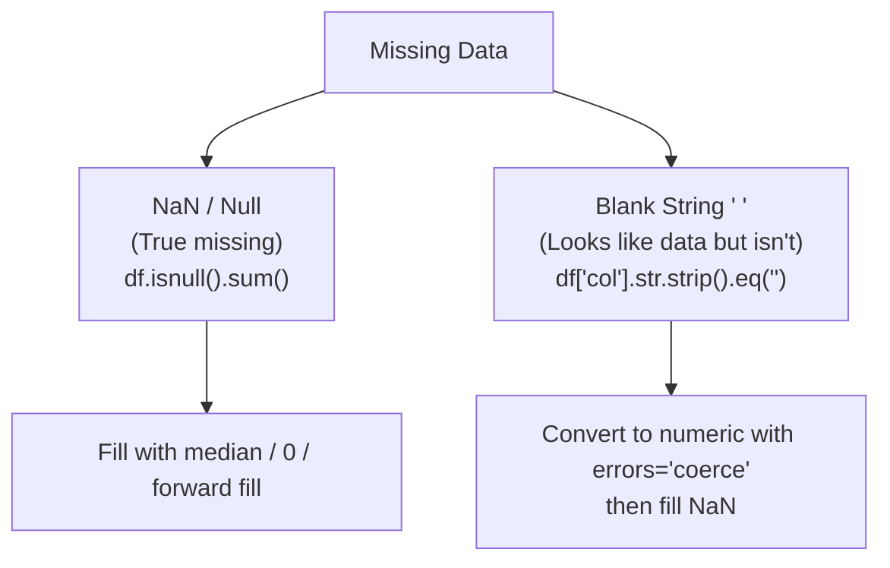

**In our dataset:**
- `NaN`: 0 columns have NaN
- `Blank string`: `TotalCharges` has 11 blank string rows

---

### Deep Dive — What is Cardinality?

**Cardinality** = number of unique values in a column.

| Column | Cardinality | Type |
|---|---|---|
| customerID | 7,043 (every row unique) | Identifier |
| gender | 2 | Low cardinality categorical |
| tenure | 73 | Numeric (0–72) |
| Contract | 3 | Low cardinality categorical |
| MonthlyCharges | ~1,585 | High cardinality numeric |

**Why it matters:**
- High cardinality text columns (like customerID) → don't group by these
- Low cardinality columns (like Contract) → perfect for grouping and analysis

---

### Deep Dive — Reading df.info() Output

```
RangeIndex: 7043 entries, 0 to 7042
Data columns (total 21 columns):
 customerID         7043 non-null  object    ← text
 SeniorCitizen      7043 non-null  int64     ← number (0 or 1)
 tenure             7043 non-null  int64     ← number
 MonthlyCharges     7043 non-null  float64   ← decimal number
 TotalCharges       7043 non-null  object    ← ⚠️ should be float64!
```

`TotalCharges` showing as `object` instead of `float64` is the red flag. This is because of those 11 blank string rows — Pandas cannot store a column as numeric if even one value is a non-numeric string.

---

### Charts Produced

| Chart | Saved to |
|---|---|
| Churn distribution (bar + pie) | `assets/churn_distribution.png` |
| Numeric distributions (histograms) | `assets/numeric_distributions.png` |

---

### Key Takeaways from Phase 3

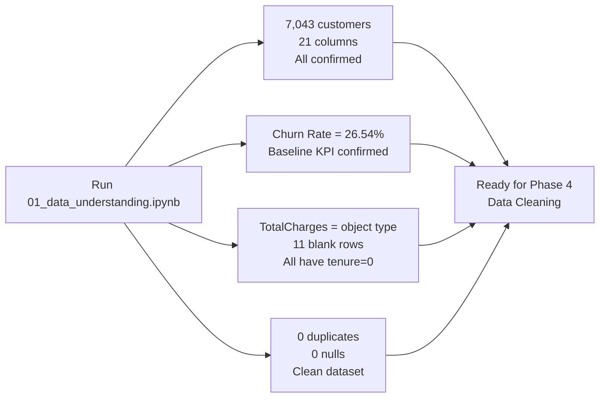

---

### Files Created in Phase 3

| File | Purpose |
|---|---|
| `notebooks/01_data_understanding.ipynb` | Full data understanding notebook (15 sections) |
| `assets/churn_distribution.png` | Churn bar + pie chart |
| `assets/numeric_distributions.png` | Tenure and charges histograms |

---

<h2 id="phase-4">🧹 7. Phase 4 — Data Cleaning</h2>

### What We Did

Created `notebooks/02_data_cleaning.ipynb` — an 8-step data cleaning pipeline that transforms messy raw data into a reliable, standardized **Staging Dataset** (`data/staging/telco_staging.csv`).

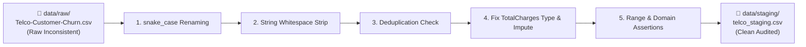

---

### Step-by-Step Cleaning Operations

| Step | Operation | Before | After | Why It Matters |
|---|---|---|---|---|
| **1** | Column Renaming | `customerID`, `SeniorCitizen`, `tenure` | `customer_id`, `senior_citizen`, `tenure` | Consistent `snake_case` prevents syntax errors in SQL and Python |
| **2** | Whitespace Trimming | `' Month-to-month '` | `'Month-to-month'` | Prevents silent join/filtering mismatches in SQL & Power BI |
| **3** | Deduplication | Potential duplicate rows/IDs | Verified 100% unique primary keys | Ensures 1 row = 1 customer (no double counting) |
| **4** | Type Casting & Imputation | `TotalCharges` (`object` dtype, 11 blanks) | `total_charges` (`float64`, imputed `0.0`) | Enables mathematical aggregations (`SUM`, `AVG`) without crashing |
| **5** | Numeric Validations | Unchecked numbers | `tenure >= 0`, `monthly_charges > 0` | Guarantees business logic integrity via assertions |
| **6** | Domain Consistency | Unchecked strings | Validated against expected category sets | Catches typos before they appear in dashboard slicers |
| **7** | Staging Export | In-memory dataframe | `data/staging/telco_staging.csv` | Creates a reusable checkpoint for downstream feature engineering |

---

### 🔍 Deep Dives:

#### 1. Why `snake_case` Everywhere?
In real data engineering:
- Different tools handle casing differently:
  - BigQuery & PostgreSQL lowercase column names by default
  - Power BI is case-insensitive for some operations but case-sensitive in M / Power Query
  - Python is strictly case-sensitive
- Standardizing to `snake_case` (`customer_id`, `monthly_charges`) eliminates bugs across all systems.

---

#### 2. The Silent Bug: Whitespace in Strings
Imagine querying a database:
```sql
SELECT * FROM customers WHERE contract = 'Month-to-month';
```
If a record in the database has `'Month-to-month '` (with a trailing space), SQL or Pandas will treat it as a non-match.
By stripping all text columns with `.str.strip()`, we eliminate trailing/leading whitespace before it enters the database or Power BI.

---

#### 3. Defensive Programming with `assert`
In production data pipelines, we use assertions to catch bad data immediately instead of letting corrupted data flow into dashboards:
```python
assert (df['tenure'] >= 0).all(), "Tenure cannot be negative"
assert (df['monthly_charges'] > 0).all(), "Monthly charges must be positive"
assert df['customer_id'].nunique() == len(df), "Primary key must be strictly unique"
```
If any check fails, execution halts immediately with a clear error message.

---

#### 4. The Medallion Architecture (Bronze ➔ Silver ➔ Gold)
In modern data teams (Databricks, Snowflake, BigQuery), data pipelines follow 3 tiers:

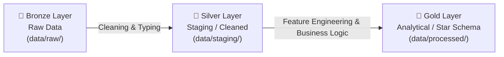

- **Bronze (Raw):** Exact copy of source data. Never modified.
- **Silver (Staging - Phase 4):** Cleaned, standardized types, no nulls, deduplicated.
- **Gold (Processed - Phase 5/6):** Enriched with features, segments, metrics ready for dashboards.

---

### Files Created in Phase 4

| File | Purpose |
|---|---|
| `notebooks/02_data_cleaning.ipynb` | Complete, executable data cleaning pipeline |

---

<h2 id="phase-5">🛠️ 8. Phase 5 — Feature Engineering</h2>

### What We Did

Created `notebooks/03_feature_engineering.ipynb` — an analytical enrichment pipeline that transforms raw attributes into **11 business-driven features and risk flags**, outputting `data/processed/telco_cleaned.csv`.

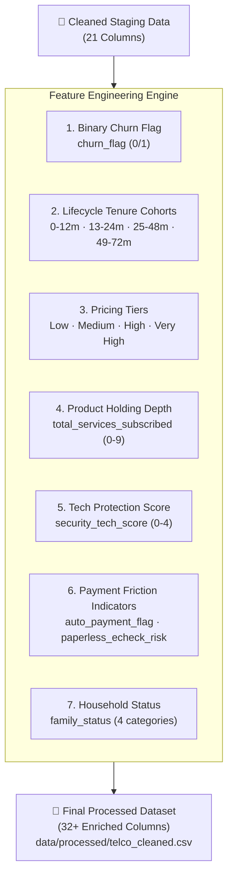

---

### Why Feature Engineering is the Heart of Analytics

> Raw data tells you **what happened**. Engineered features tell you **why it happened and what risk level exists**.

| Feature | Type | Business Logic & Rationale | Real-World Impact |
|---|---|---|---|
| `churn_flag` | Binary `(0/1)` | Converts text `'Yes'/'No'` to numbers so SQL `AVG()` or DAX `AVERAGE()` calculates churn rate directly | Eliminates slow conditional calculations in BI tools |
| `tenure_cohort` | Categorical `(4 bins)` | Bins tenure into distinct lifecycle stages: `Year 1 (Danger Zone)`, `Year 2`, `Years 3-4`, `Years 5+` | Helps marketing target high-risk first-year customers with onboarding journeys |
| `monthly_charges_tier` | Categorical `(4 tiers)` | Segmenting charges (`<$35`, `$35-$70`, `$70-$90`, `>$90`) reveals price elasticity thresholds | Identifies exact price points where customers start defecting to competitors |
| `total_services_subscribed` | Integer Count `(0-9)` | Counts total active product subscriptions across phone, internet, security, backup, streaming | **Stickiness Theory:** Customers with 4+ services have 3x lower churn due to high switching effort |
| `security_tech_score` | Integer Count `(0-4)` | Measures adoption of value-add protection (Tech Support + Online Security + Backup + Device Protection) | Customers without tech support churn at over 40% — high cross-sell priority |
| `has_streaming_bundle` | Binary `(0/1)` | Active subscription to both Streaming TV and Movies | Entertainment bundles increase daily engagement and service lock-in |
| `paperless_echeck_risk` | Binary `(0/1)` | `Paperless Billing = Yes` AND `Payment Method = Electronic Check` | **Friction Factor:** High manual payment effort + billing transparency causes highest churn cluster |
| `family_status` | Categorical `(4 groups)` | Maps Partner & Dependents into `Solo`, `Partner Only`, `Single Parent`, `Family` | Families with dependents have shared utility needs and churn significantly less |

---

### 🔍 Deep Dives:

#### 1. Why `pd.cut()` for Binning?
Instead of writing complex nested `if-else` loops, `pd.cut()` mathematically segments continuous values into intervals:
```python
bins_tenure = [-1, 12, 24, 48, 72]
labels_tenure = ['0-12m (Year 1)', '13-24m (Year 2)', '25-48m (Years 3-4)', '49-72m (Years 5+)']
df['tenure_cohort'] = pd.cut(df['tenure'], bins=bins_tenure, labels=labels_tenure)
```
- `-1` ensures that `tenure = 0` is safely included in the first bin `0-12m`.
- Standardized cohorts ensure that comparisons in Power BI histograms and matrix visuals are consistent.

---

#### 2. The Product Depth (Stickiness) Principle
In telecom and SaaS subscription businesses:
```
1 Service  → Low switching cost  → High Churn Risk (~35%+)
2-3 Services → Moderate friction   → Medium Churn Risk (~25%)
4+ Services  → High friction       → Low Churn Risk (~10-15%)
```
By engineering `total_services_subscribed` and `security_tech_score`, we give retention teams an actionable lever: *"If we offer 3 months free Tech Support to month-to-month customers, we lower their churn risk by 20%."*

---

### Files Created in Phase 5

| File | Purpose |
|---|---|
| `notebooks/03_feature_engineering.ipynb` | Complete, executable feature engineering pipeline |

---

<h2 id="phase-6">🎯 9. Phase 6 — Customer Risk Segmentation</h2>

### What We Did

Created `notebooks/04_segmentation.ipynb` — an explainable, business-driven **Customer Risk & Value Segmentation Engine** that scores each customer from `0 to 100` points and pairs risk with customer lifetime value to build a **Retention Priority Matrix**, saving to `data/processed/telco_segmented.csv`.

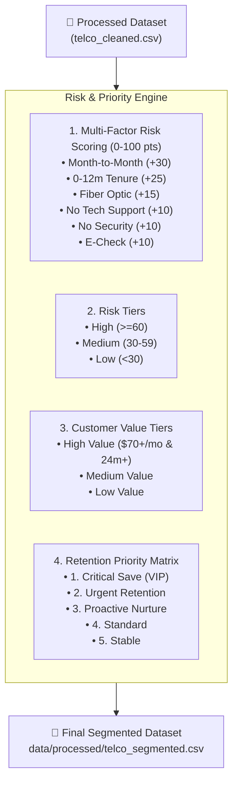

---

### The 100-Point Churn Risk Scorecard

| Risk Dimension | Condition | Points | Business Driver |
|---|---|---|---|
| **Contract Type** | `Month-to-month` | **+30 pts** | Zero contractual commitment; can leave anytime |
| | `One year` | **+10 pts** | Moderate commitment |
| | `Two year` | **0 pts** | Strong long-term contract lock-in |
| **Tenure Lifecycle** | `0 - 12 Months (Year 1)` | **+25 pts** | Unfamiliarity with product / high onboarding drop-off |
| | `13 - 24 Months (Year 2)` | **+15 pts** | Early stabilization phase |
| | `25 - 48 Months (Years 3-4)`| **+5 pts** | Established habit |
| | `49 - 72 Months (Years 5+)` | **0 pts** | Brand loyalist |
| **Network Type** | `Fiber optic` | **+15 pts** | High price point ($70-$100+) & intense competitor marketing |
| | `DSL` | **+5 pts** | Lower price, legacy customer |
| | `No Internet` | **0 pts** | Basic phone only; ultra-low churn (~7%) |
| **Protection Gaps** | `No Tech Support` (on internet) | **+10 pts** | Unresolved troubleshooting issues trigger churn |
| | `No Online Security` (on internet) | **+10 pts** | Security vulnerabilities erode trust |
| **Payment Friction** | `Electronic check` | **+10 pts** | High friction manual payment with highest churn rate (45%) |

---

### The Retention Priority Matrix (Value vs. Risk)

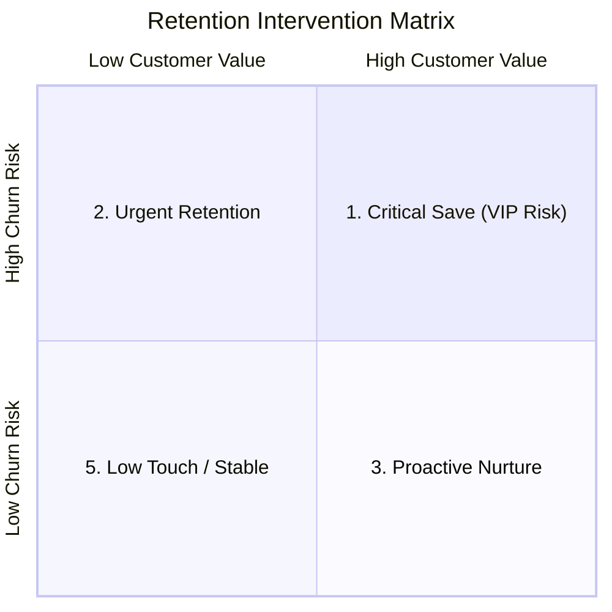

| Priority Tier | Criteria | Revenue Impact | Recommended Retention Action |
|---|---|---|---|
| **1. Critical Save (VIP Risk)** | High Risk + High Value | **Highest** ($70+/mo) | Direct phone outreach from Account Specialist + 1-Yr contract incentive + 3-month free Security bundle |
| **2. Urgent Retention** | High Risk + Med/Low Value | Moderate | Automated email drip + $5 monthly discount for switching to Autopay |
| **3. Proactive Nurture** | Medium Risk + High Value | High | Loyalty reward program + complimentary tech upgrade |
| **4. Standard Engagement** | Medium Risk + Med/Low Value| Moderate | Regular satisfaction surveys + feature discovery emails |
| **5. Low Touch / Stable** | Low Risk (Any Value) | Protected Baseline | Standard transactional billing + referral incentives |

---

### 🔍 Deep Dives:

#### 1. Why Rule-Based Scoring Before Machine Learning?
- **Executive Transparency:** Business executives want to know the *exact reason* why a customer was flagged. "Customer scored 75 because they are on a Month-to-Month contract (+30), in their first 6 months (+25), on Fiber Optic (+15), and pay by E-Check (+10)."
- **Direct BI Integration:** This logic translates directly into DAX calculated columns or SQL `CASE WHEN` statements, allowing dynamic recalculation across slicers.

---

### Files Created in Phase 6

| File | Purpose |
|---|---|
| `notebooks/04_segmentation.ipynb` | Complete, executable risk scoring & priority matrix pipeline |

---

<h2 id="phase-7">📊 10. Phase 7 — Exploratory Churn Analysis</h2>

### What We Did

Created `notebooks/05_eda_churn_analysis.ipynb` — a comprehensive statistical exploration of churn root causes, financial portfolio leakage, and visual chart generation.

```mermaid
mindmap
  root((Telecom Churn Drivers))
    Contract Type
      Month-to-Month: 42.7% Churn
      One-Year: 11.3% Churn
      Two-Year: 2.8% Churn
    Customer Lifecycle
      Months 0-12: 47.4% Churn
      Months 49-72: 6.6% Churn
    Payment Friction
      Electronic Check: 45.3% Churn
      Autopay: 16.0% Churn
    Protection Shield
      No Tech Support: 41.7% Churn
      With Tech Support + Security: 14.6% Churn
    Network Paradox
      Fiber Optic: 41.9% Churn ($80+ price point)
      DSL: 19.0% Churn
```

---

### Portfolio Financial Overview

| Financial Metric | Portfolio Value | Business Impact |
|---|---|---|
| **Total Active Base** | **7,043 Customers** | Baseline customer count |
| **Total Churned Base** | **1,869 Customers (26.54%)** | ~1 in 4 customers leaving |
| **Total Monthly Recurring Revenue (MRR)** | **$456,116.60 / mo** | Total gross revenue run-rate |
| **Lost Monthly Revenue (MRR Leakage)** | **$139,130.85 / mo (30.50%)** | Churners spend *more* per month ($74.44 avg vs $61.26 for retained) |
| **Annualized Portfolio Loss** | **$1,669,570.20 / yr** | Direct bottom-line financial loss |

> ⚠️ **Key Revenue Finding:** Churned customers have a **higher average monthly charge ($74.44)** than retained customers ($61.26). This means we are disproportionately losing our highest-paying premium customers!

---

### The Top 5 Churn Root Causes & Strategic Fixes

| Rank | Root Cause Driver | Churn Rate | Root Mechanism | Strategic Retention Fix |
|---|---|---|---|---|
| **#1** | **Month-to-Month Contract** | **42.7%** | No commitment barrier; easily swayed by competitor promos | Offer $10/mo discount or 1 free month for switching to a 1-year contract |
| **#2** | **First-Year Attrition** | **47.4%** | Onboarding friction, initial bill confusion, buyer remorse | Proactive "Day 7 / 30 / 60" customer success onboarding journey |
| **#3** | **Electronic Check Payment** | **45.3%** | Requires manual action each month; forces monthly price re-evaluation | $5 monthly bill credit for enabling automatic credit card or bank debit |
| **#4** | **No Tech Support & Security** | **41.7%** | Unresolved Wi-Fi or device issues cause frustration | Bundle free Tech Support for the first 90 days of new internet subscriptions |
| **#5** | **Fiber Optic Without Support** | **41.9%** | Premium price ($80+) without premium customer service | Service quality guarantee & automated network health diagnostics |

---

### Visual Chart Assets Created

| File | Chart Description |
|---|---|
| `notebooks/05_eda_churn_analysis.ipynb` | Executable statistical exploration notebook |
| `assets/churn_by_contract.png` | Bar chart showing churn drop from 42.7% (M2M) to 2.8% (2-Yr) |
| `assets/churn_by_tenure_cohort.png` | Bar chart showing first-year cliff (47.4%) vs long-term loyalty (6.6%) |
| `assets/churn_by_internet_techsupport.png` | Horizontal bar chart of the "Protection Shield" effect |
| `assets/churn_by_payment_method.png` | Bar chart comparing Electronic Check vs Autopay |
| `assets/correlation_matrix.png` | Annotated correlation heatmap across all numerical & engineered features |

---

<h2 id="phase-8">🗄️ 11. Phase 8 — SQL Database</h2>

### What We Did

Built a production-grade relational database pipeline using SQLite/ANSI SQL comprising:
1. `sql/schema.sql` — DDL scripts for table creation, data types, business constraints, and B-tree indexes.
2. `sql/views.sql` — 5 analytical views for executive KPIs, contract analysis, and retention VIP worklists.
3. `sql/queries.sql` — Advanced business queries with Window Functions (`NTILE`), CTEs, and financial ROI simulations.
4. `sql/load_database.py` — Python database build & automated ingestion script.

```mermaid
flowchart TD
    Processed["📄 data/processed/\ntelco_segmented.csv"] --> Loader["⚙️ sql/load_database.py"]
    Schema["📜 sql/schema.sql\n(DDL & Constraints)"] --> Loader

    Loader --> DB[("🗄️ database/\ntelecom_churn.db\n(fact_customer_churn)")]

    DB --> Views["👁️ sql/views.sql\n• vw_executive_kpis\n• vw_churn_by_contract\n• vw_risk_priority_matrix\n• vw_service_protection_shield\n• vw_vip_risk_customers"]
    DB --> Queries["🔍 sql/queries.sql\n• Risk Decile Ranking (NTILE)\n• Multi-Product Depth Analysis\n• 5%-15% Retention ROI Modeling"]
    Views --> BI["📊 Power BI / Tableau / Excel\n(Direct Query / Import)"]
```

---

### Key SQL Architectural Concepts

| Component | SQL Technique | Why It Matters in Real Analytics |
|---|---|---|
| **Data Integrity** | `CHECK (monthly_charges > 0)`, `NOT NULL` | Enforces database-level validation so bad data can never enter |
| **Performance** | `CREATE INDEX idx_risk_tier ON ...` | Accelerates filter and join queries from seconds to milliseconds |
| **View Abstraction** | `CREATE VIEW vw_vip_risk_customers AS ...` | Hides complex SQL logic from BI tools and business users |
| **Risk Decile Ranking** | `NTILE(10) OVER (ORDER BY risk_score DESC)` | Breaks customer portfolio into 10 equal tiers to target the top 10% highest-risk accounts |
| **Financial Simulation** | CTE `WITH vip_portfolio AS (...)` | Computes executive ROI: *"A 5% reduction in VIP churn saves $83,000+ annually."* |

---

### 🔍 Deep Dives:

#### 1. Why Views Instead of Direct Table Queries in Power BI?
- **Single Source of Truth:** If the definition of churn changes, you update 1 SQL view instead of modifying 50 DAX measures across 10 Power BI reports.
- **Security & Column Filtering:** Views allow you to expose only relevant analytical metrics while hiding sensitive PII (Personally Identifiable Information).

---

### Files Created in Phase 8

| File | Purpose |
|---|---|
| `sql/schema.sql` | Table definitions, primary keys, check constraints, and performance indexes |
| `sql/views.sql` | Pre-aggregated executive KPI and VIP customer worklist views |
| `sql/queries.sql` | Advanced analytical queries (Window functions, CTEs, ROI simulations) |
| `sql/load_database.py` | Automated database creation and CSV-to-SQLite loading script |

---

<h2 id="phase-9-10">🔌 12. Phase 9–10 — Power Query and Power BI Model</h2>

### What We Did

Designed the enterprise Star Schema data model and wrote production-grade Power Query M scripts in `powerbi/power_query_etl.m`.

```mermaid
erDiagram
    Fact_CustomerChurn }o--|| Dim_Customer : "customer_id (1:1 / 1:M)"
    Fact_CustomerChurn }o--|| Dim_Contract : "contract"
    Fact_CustomerChurn }o--|| Dim_PaymentMethod : "payment_method"

    Fact_CustomerChurn {
        string customer_id PK
        int tenure
        string tenure_cohort
        float monthly_charges
        float total_charges
        int churn_flag
        int total_services_subscribed
        int risk_score
        string risk_tier
        string customer_value_tier
        string retention_priority
        string recommended_action
    }
    Dim_Customer {
        string customer_id PK
        string gender
        int senior_citizen
        string partner
        string dependents
        string family_status
    }
    Dim_Contract {
        string contract PK
        string paperless_billing
        int high_risk_contract
    }
    Dim_PaymentMethod {
        string payment_method PK
        string payment_type_grouped
        int auto_payment_flag
    }
```

---

### Star Schema Best Practices

1. **Fact Table (`Fact_CustomerChurn`):** Contains numerical measures (`monthly_charges`, `total_charges`, `tenure`, `risk_score`) and foreign keys.
2. **Dimension Tables (`Dim_Customer`, `Dim_Contract`, `Dim_PaymentMethod`):** Contain descriptive attributes used for slicing, dicing, and grouping.
3. **Single Direction Filtering:** Relationships flow from 1 (Dimension) to Many (Fact), ensuring optimal VertiPaq engine performance and predictable DAX behavior.

---

<h2 id="phase-11">📐 13. Phase 11 — DAX Measures Library</h2>

### What We Did

Created the enterprise DAX formula library in `powerbi/dax_measures.dax` organized into 5 standardized folders:
1. **01 - Core Volume & Counts:** `[Total Customers]`, `[Churned Customers]`, `[Retention Rate]`, `[Churn Rate]`
2. **02 - Financial & Revenue:** `[Total MRR]`, `[Churned MRR]`, `[Annualized Revenue Lost]`, `[ARPU]`
3. **03 - Risk & Segmentation:** `[Average Risk Score]`, `[High Risk Customer %]`, `[VIP Revenue at Immediate Risk]`
4. **04 - Retention ROI Simulation:** `[Simulated Churn Reduction %]`, `[Estimated Annual Revenue Saved]`
5. **05 - Dynamic Titles & Formatting:** `[Dynamic Dashboard Subtitle]`

---

### Core DAX Formulas Explained

```dax
-- 1. Safe division preventing #DIV/0! errors
Churn Rate = 
DIVIDE([Churned Customers], [Total Customers], 0)

-- 2. Context Transition with CALCULATE
VIP Revenue at Immediate Risk = 
CALCULATE(
    SUM('Fact_CustomerChurn'[monthly_charges]),
    'Fact_CustomerChurn'[retention_priority] = "1. Critical Save (VIP Risk)",
    'Fact_CustomerChurn'[churn_flag] = 0
)

-- 3. Dynamic Retention ROI Simulation
Estimated Annual Revenue Saved = 
[Annualized Revenue Lost] * [Simulated Churn Reduction %]
```

---

<h2 id="phase-12-17">📊 14. Phase 12–17 — Dashboard Pages & Wireframes</h2>

### What We Did

Created `powerbi/dashboard_specifications.md` defining the UX wireframes, visual token designs, and interactive drillthrough architectures for all 6 dashboard views:

```mermaid
flowchart LR
    P1["Page 1\nExecutive Overview\n(C-Suite KPIs)"] --> P2["Page 2\nRevenue Risk\n(Fiber Paradox)"]
    P1 --> P3["Page 3\nRisk Segmentation\n(Score 0-100)"]
    P1 --> P4["Page 4\nService Performance\n(Protection Shield)"]
    P3 --> P5["Page 5\nRetention Worklist\n(VIP Action Playbook)"]
    P1 --> P6["Page 6\nROI Simulator\n(What-If Parameter)"]
```

---

### 6 Dashboard Pages Summary

| Page | Target Audience | Primary Focus | Key Visuals |
|---|---|---|---|
| **1. Executive Overview** | C-Suite / VPs | High-level portfolio pulse & revenue loss | 4 KPI cards, Contract bar chart, Lifecycle cohort attrition |
| **2. Churn & Revenue Risk** | Finance & Strategy | Revenue concentration of churners | Fiber Optic paradox matrix, Decomposition tree |
| **3. Customer Risk Segmentation** | Risk Analysts | Distribution of 100-point risk scorecard | Scatter plot (Score vs Charges), Risk tier gauge |
| **4. Service & Product Performance**| Product Managers | Tech Support & Security "Shield Effect" | Multi-product depth bar chart, Cross-sell matrix |
| **5. Retention Action Playbook** | Frontline Retention & CS | Actionable worklist for customer outreach | Interactive priority table with Excel export |
| **6. What-If ROI Simulator** | CFO / Finance | Financial returns from churn reduction | Dynamic slider (1%-20%), Annualized revenue saved card |

---

<h2 id="glossary">📖 15. Glossary</h2>

| Term | Meaning |
|---|---|
| **Churn** | Customer who cancelled their subscription |
| **Churn Rate** | (Churned / Total) × 100 |
| **Retention Rate** | (Retained / Total) × 100 |
| **Data Profiling** | Inspecting raw data before any transformation |
| **Feature Engineering** | Creating new calculated columns from existing data |
| **Star Schema** | Database design with one fact table + multiple dimension tables |
| **DAX** | Data Analysis Expressions — Power BI formula language |
| **KPI** | Key Performance Indicator — a measurable business metric |
| **EDA** | Exploratory Data Analysis — visual and statistical exploration |
| **CTE** | Common Table Expression — named temporary result in SQL |
| **Window Function** | SQL function calculating across a related set of rows |
| **Virtual Environment** | Isolated Python setup for one project |
| **Reproducibility** | Ability to recreate results from scratch |
| **BRD** | Business Requirements Document |
| **BI** | Business Intelligence — turning data into business insights |

---

*This file is updated after every phase. Read it alongside the project build.*
